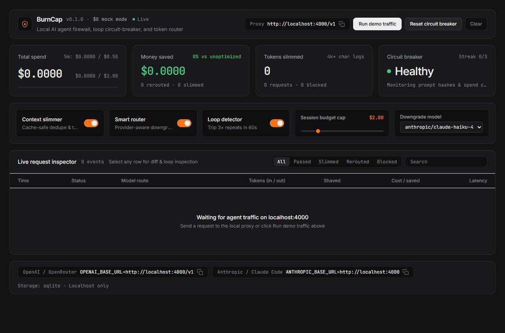
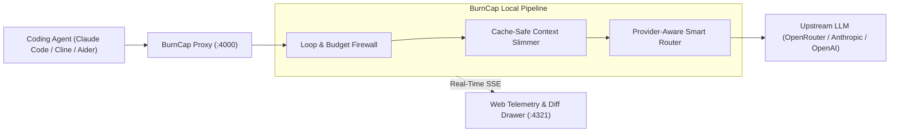

# BurnCap

**A local AI agent firewall, loop circuit-breaker, and smart token router with a real-time web dashboard.**

[](https://opensource.org/licenses/MIT)
[](https://www.typescriptlang.org/)
[](#how-it-works)
[](#quickstart-under-30-seconds)



*BurnCap intercepting a runaway coding loop, truncating an oversized stack trace, and opening the side-by-side diff & loop forensics drawer at `http://localhost:4321`.*

---

## The Problem

Autonomous coding agents burn tokens at machine speed when left unsupervised:

- **Runaway agent loops burn $20 while you grab coffee:** A failing test or missing database connection causes an agent to retry the exact same tool call dozens of times in a row until your API credit limit is gone.
- **Bloated 50k-token stack traces sent on every turn:** Giant `node_modules` stack frames, webpack build dumps, and duplicate system blocks accumulate in conversation history and get re-billed on every single request.
- **Frontier models wasted on simple JSON/title tasks:** Agents routinely fire `claude-sonnet-4.5` or `gpt-4.1` just to generate a 4-word chat title, summarize history, or run lightweight tool-free classifications.

BurnCap sits between your coding agent and the upstream LLM on `localhost:4000` to catch all three automatically—without breaking streaming tool calls or Anthropic prompt caching.

---

## Quickstart (Under 30 Seconds)

Try the live dashboard and firewall completely offline for **$0.00** (no API keys required):

```bash
npx burncap --mock
```

Open **[http://localhost:4321](http://localhost:4321)** and click **Run demo traffic** to watch BurnCap pass coding requests, downgrade auxiliary calls, shave oversized stack traces, and trip the loop circuit-breaker on the 3rd identical failure.

### 1-Line Setup for Your Coding Agent

Start BurnCap in live proxy mode (`npx burncap`) and point your agent to `http://localhost:4000`:

- **Claude Code:**
  ```bash
  ANTHROPIC_BASE_URL=http://localhost:4000 claude
  ```
- **OpenRouter (any OpenAI-compatible agent):**
  ```bash
  export OPENAI_BASE_URL=http://localhost:4000/api/v1
  ```
- **Aider:**
  ```bash
  OPENAI_API_BASE=http://localhost:4000/v1 aider
  ```
- **Cline / Roo Code / Cursor:**
  Set the provider **Base URL** to `http://localhost:4000/v1` (OpenAI/OpenRouter) or `http://localhost:4000` (Anthropic).

---

## How It Works



1. **Loop & Budget Firewall ([`src/firewall.ts`](src/firewall.ts)):** Normalizes and SHA-256 hashes the last 3 `user`/`tool` messages; 3 consecutive repeats within 60 seconds trip the circuit breaker (`HTTP 429` `BLOCKED: LOOP`). Enforces session (`$2.00`) and 5-minute window (`$0.50`) spend hard-caps (`HTTP 402`/`429` `BLOCKED: BUDGET`).
2. **Cache-Safe Context Slimmer ([`src/optimizer.ts`](src/optimizer.ts)):** Detects Anthropic `cache_control` breakpoints and never mutates any `system` block or message at or before the last breakpoint so upstream prompt cache hits stay intact. Deduplicates consecutive uncached system blocks and deterministically truncates new `>4,000`-character tool outputs (`1,500` head + `[...BurnCap truncated middle lines to save tokens...]` + `1,500` tail).
3. **Provider-Aware Smart Router ([`src/optimizer.ts`](src/optimizer.ts)):** Downgrades tool-free prompts under 300 tokens or auxiliary tasks (titles, summaries) to your selected fast model—strictly using `claude-haiku-4-5` when `/v1/messages` receives `x-api-key`, and preserving `provider/model` prefixes (such as `anthropic/claude-haiku-4.5` or `google/gemini-2.5-flash`) for OpenRouter.
4. **Real-Time Inspector Drawer ([`src/dashboard.html`](src/dashboard.html)):** Click any row in the live table to inspect redacted request headers, firewall/optimizer/upstream latency breakdown, side-by-side truncation diffs with token/cost math, and exact repeated loop payloads with matching hashes.

---

## CLI Options

| Flag | Default | Description |
| --- | --- | --- |
| `-m, --mock` | `false` | Run in `$0` offline mock upstream mode (zero external API calls) |
| `-p, --port <port>` | `4000` | Local proxy port |
| `-d, --dashboard-port <port>` | `4321` | Real-time web dashboard port |
| `-u, --upstream <url>` | `https://openrouter.ai/api` | Target upstream URL (also configurable via `BURNCAP_UPSTREAM` or `x-burncap-upstream`) |
| `-b, --budget <usd>` | `2.00` | Session spend hard-cap in USD |
| `--window-budget <usd>` | `0.50` | Rolling 5-minute spend velocity cap in USD |
| `--cheap-model <model>` | `anthropic/claude-haiku-4.5` | Smart Router downgrade model target |
| `--no-slimmer` | — | Disable Context Slimmer middleware on startup |
| `--no-router` | — | Disable Smart Model Router on startup |
| `--no-loop-detector` | — | Disable Loop Detector on startup |

---

## Project Structure

```text
burncap/
├── package.json
├── tsconfig.json
├── README.md
├── src/
│   ├── index.ts          # CLI entrypoint, ASCII startup banner & dashboard server
│   ├── proxy.ts          # Hono streaming SSE/JSON proxy (/v1/chat/completions, /v1/messages)
│   ├── firewall.ts       # Loop detector & budget circuit-breaker logic
│   ├── optimizer.ts      # Cache-safe context slimmer & provider-aware smart router
│   ├── pricing.ts        # Model token cost lookup table & savings calculator
│   ├── state.ts          # Ring buffer + node:sqlite / JSON persistence + SSE emitter
│   ├── mock.ts           # $0 offline SSE mock upstream & /api/simulate-traffic burst
│   └── dashboard.html    # Single-file dark-mode telemetry UI & request diff drawer
└── tests/
    └── burncap.test.ts   # Unit & end-to-end integration test suite
```

---

## Contributing

Contributions are welcome! Two of the highest-impact places to open a PR:

- **New Model Pricing Presets:** Add newly released frontier, reasoning, or `:free` model pricing rules to `PRICING_RULES` in [`src/pricing.ts`](src/pricing.ts) so savings math and smart-routing comparisons stay accurate.
- **Custom Context-Slimming Rules:** Add framework-specific stack trace matchers, noisy CLI output compactors, or smart-trimming rules in [`src/optimizer.ts`](src/optimizer.ts) alongside tests in [`tests/burncap.test.ts`](tests/burncap.test.ts).

```bash
npm install
npm run typecheck
npm run build
npm test
```

## License

MIT
